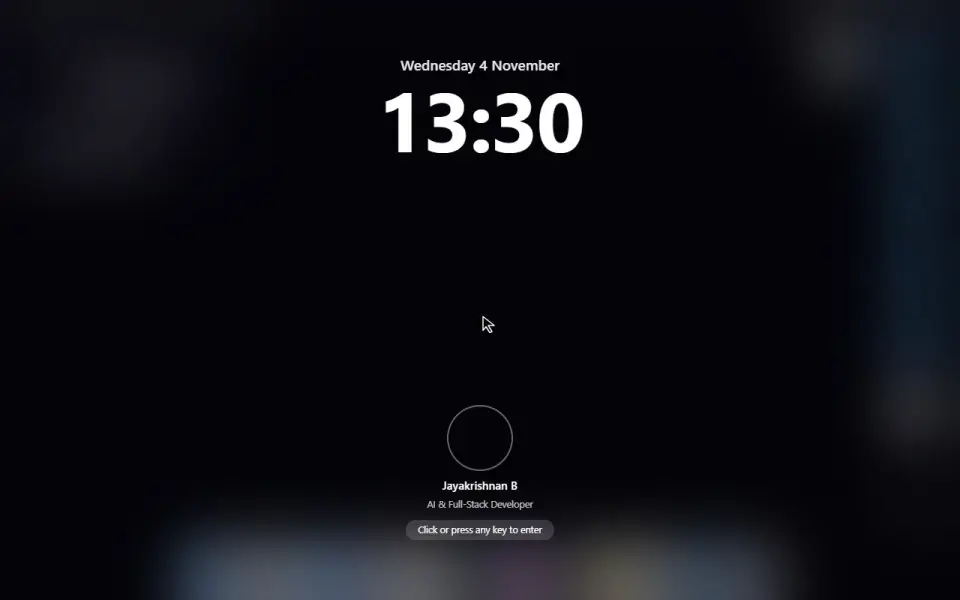

# Portfolio

Personal site of Jayakrishnan B: a portfolio that works like a desktop OS. Built with React, Tailwind and Framer Motion.

Inspired by macOS. All artwork is original; no Apple logos, icons, fonts or wallpapers are used.

**[Open the live site](https://jrkrish.github.io/Portfolio-JK/)**

[](https://jrkrish.github.io/Portfolio-JK/)

*A 40-second tour, recorded from the live site. [Watch it full size](docs/demo.webm).*

```bash
npm install
npm run dev
```

- **Change the content:** everything lives in the file tree in `src/fs.js`.
- **Add a project:** add a `project({ ... })` entry there and an image to `public/previews/`.
- **Publish:** push to `main`. `.github/workflows/deploy.yml` builds and deploys to GitHub Pages.
- **Redraw the project covers:** `npm run covers` (needs Microsoft Edge).
- **Run the browser tests:** start `npm run dev`, then `npm run test:e2e`.
- **Record the demo:** `node tools/record_demo.mjs`, then `python tools/encode_demo.py`.
